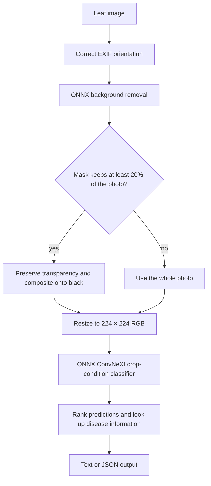

# CropCheckUp

CropCheckUp is a Python command-line tool for identifying crop-leaf conditions
from images. It combines ONNX background removal with a ConvNeXt classifier,
also run with ONNX Runtime, to predict **38 crop and condition labels across 14
crops**, including healthy leaves, diseases, and pest damage.

Each result includes the predicted crop and condition, a confidence score, and
alternative predictions. Symptoms, causes, and management information are
included when available. All image processing and inference run locally, so
images do not need to be uploaded to a service.

## Technical highlights

- **Transfer learning:** an ImageNet-22k-pretrained ConvNeXt-Tiny is
  fine-tuned end to end on PlantVillage leaves whose backgrounds were removed
  with BiRefNet.
- **Training for varied inputs:** augmentation covers rotation, flips, tight
  random crops, colour jitter, and blur. Classes are sampled in proportion to
  the square root of their size, and the train/test split keeps duplicate
  photos of one leaf together.
- **Two-model inference pipeline:** ONNX Runtime produces a foreground mask,
  falling back to the whole photo when the mask keeps too little, and then
  classifies the processed leaf image.
- **Inspectable preprocessing:** EXIF orientation and transparency are handled
  explicitly, and the exact classifier input can be saved as a PNG.
- **Scriptable interface:** an installable `cropcheckup` command supports
  configurable top-k predictions, custom model directories, and JSON output
  with diagnostics routed to stderr.
- **Validation and tests:** model tensor shapes and types are checked, invalid
  outputs produce clear errors, and tests cover preprocessing, CLI behavior,
  background removal, and inference with the local models.

## Architecture



| Component | Technology / responsibility |
| --- | --- |
| Model training | PyTorch and timm on Kaggle, in the CropCheckUp-training repository |
| Classification and background removal | ONNX Runtime with CPU inference |
| Image preparation | Pillow and NumPy |
| Command-line interface | Python `argparse`, text and JSON output |
| Packaging and tests | `setuptools`, `unittest` |

## Dataset and model training

The classifier is trained on the CropCheckUp dataset, built from source
datasets including PlantVillage and the Mango Leaf Disease Dataset.

The [label list](src/cropcheckup/models/labels.txt) covers apple, blueberry,
cherry, corn, grape, orange, peach, bell pepper, potato, raspberry, soybean,
squash, strawberry, and tomato. The 38 labels are the PlantVillage
crop–condition pairs.

The classifier is trained in the
[CropCheckUp-training](https://github.com/rasagyavatsal/CropCheckUp-training)
repository by a Kaggle notebook with the following configuration:

| Setting | Configuration |
| --- | --- |
| Data | 54,205 PlantVillage images, backgrounds removed with BiRefNet-General and composited onto black |
| Backbone | ConvNeXt-Tiny, ImageNet-22k pretrained, fine-tuned end to end |
| Input | 224 × 224 RGB images |
| Data split | 80% training / 10% validation / 10% test, grouped by photo so duplicates share a split |
| Batch size | 64 |
| Optimiser | AdamW, learning rate 0.0003, weight decay 0.05, one warm-up epoch, then cosine decay over 12 epochs |
| Training controls | √count class sampling, label smoothing 0.1, mixed precision, best epoch chosen by validation balanced accuracy |
| Export | ONNX taking float32 RGB in `[0, 255]` and returning softmax probabilities, plus labels in model output order |

Results on the 5,371-image test split:

| Input | Accuracy | Balanced accuracy |
| --- | --- | --- |
| BiRefNet cutouts, as in training | 99.61% | 99.20% |
| Centre crop hiding the background | 99.48% | 99.08% |
| Raw photos through this CLI's background removal and fallback | about 99.4% | — |

These are PlantVillage photos taken against plain backgrounds. Accuracy on
field photos has not been measured and will be lower.

## Setup

Use Python 3.12. From the repository root, create an environment and install
the dependencies:

```sh
python3.12 -m venv .venv
. .venv/bin/activate
python -m pip install -e .
```

The package dependencies are ONNX Runtime, NumPy, and Pillow. The models run
locally; inference does not need a network connection.

The classifier model, `plant_disease_model.onnx` (112 MB), is over GitHub's file
size limit and is not in this repository. Copy it from a training run's output
into `src/cropcheckup/models/`, where it is gitignored.

## Classify an image

```sh
cropcheckup leaf.jpg
cropcheckup leaf.jpg --save-processed processed.png
cropcheckup leaf.jpg --json
```

The CLI accepts PNG, JPEG, WebP, and other Pillow-readable formats.

- `--top-k 5`: show the five highest-scoring predictions (default: 3).
- `--json`: output results as JSON; diagnostics go to stderr.
- `--save-processed PATH`: save the final 224×224 RGB classifier input as a
  lossless PNG for visual inspection. The source image is left intact and cannot
  be used as the output path.
- `--model-dir PATH`: load `plant_disease_model.onnx`, `labels.txt`,
  `disease_info.json`, and `background_removal.onnx` from another directory
  (default: the package's bundled models directory, located at
  `src/cropcheckup/models/` in this repository). All four files are required.

## Image preprocessing

By default, the CLI corrects EXIF orientation, removes the background with the
bundled ONNX model, preserves existing transparency, and composites the result
onto black. It then resizes the entire image to 224×224 with bilinear
interpolation and passes float32 RGB values in `[0, 255]` to the classifier,
which normalises them itself. Rectangular images are resized without cropping or padding. If
background removal fails, classification stops with an error instead of using
the original photo.

On close-ups where the leaf fills the frame, the background-removal model often
finds no subject and erases most of the leaf. When the mask keeps less than 20%
of the photo, the CLI classifies the whole photo instead.

Background removal adds CPU work and memory use. The ONNX file is about
4.6 MB. Its input is 320×320, but the mask is applied at the source image's full
resolution, with no 1024-pixel limit.

### Background-removal model

The bundled [`background_removal.onnx`](src/cropcheckup/models/background_removal.onnx) was
recovered from the [historical CropCheckUp browser implementation](https://github.com/rasagyavatsal/CropCheckUp/tree/b8036567f6af4208d61202167a3022549ebfdc75).
It was previously used for app input images. The training images were cut out
with the much larger BiRefNet-General instead; with the fallback above, using
this model costs about 0.2 points of test accuracy. The ONNX asset is BSD
3-Clause licensed.

## Train the model

Training lives in the
[CropCheckUp-training](https://github.com/rasagyavatsal/CropCheckUp-training)
repository. Its `kaggle/train/` notebook trains the classifier on a Kaggle T4
GPU in about 85 minutes and writes `plant_disease_model.onnx`, `labels.txt`,
and test metrics to the notebook's output.

With an editable install, copy `plant_disease_model.onnx` and its matching
`labels.txt` into `src/cropcheckup/models/`, keeping `disease_info.json` and
`background_removal.onnx` alongside them. For a regular install, put all four
files in another directory and select it with `--model-dir`. The CLI requires
38 labels in model output order.

## Tests

The test suite covers image orientation, alpha compositing, tensor preparation,
processed-image export, text and JSON output, model validation, and error
handling. It also includes an inference smoke test using the local models
and a generated image, which is skipped when `plant_disease_model.onnx` is
missing.

```sh
python -m unittest discover -s tests -p 'test_*.py' -v
```

## License and attribution

Source code: Apache-2.0. The classifier assets are CC-BY-NC-SA-4.0
(non-commercial); the background-removal model is BSD 3-Clause.
