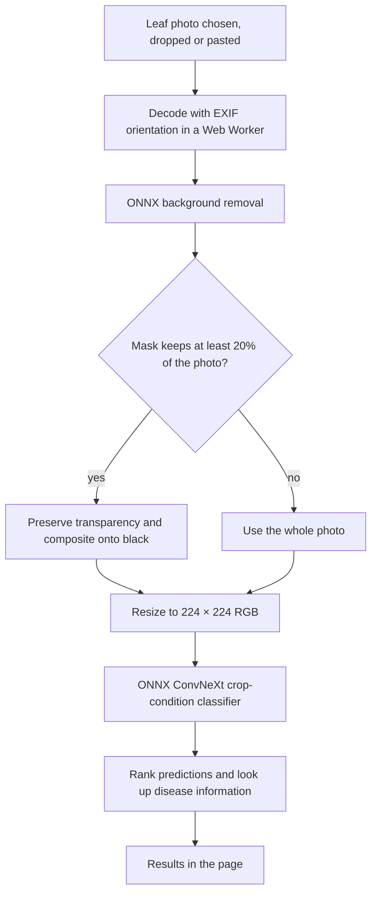

# CropCheckUp

CropCheckUp is a web app for identifying crop-leaf conditions from photos. It
combines ONNX background removal with a ConvNeXt classifier, both run in the
browser with ONNX Runtime Web, to predict **38 crop and condition labels across
14 crops**, including healthy leaves, diseases, and pest damage.

Each result includes the predicted crop and condition, a confidence score, and
alternative predictions. Symptoms, causes, and management information are
included when available. All image processing and inference run in the browser,
so photos are never uploaded.

**Try it:** <https://cropcheckup-893696572314.us-central1.run.app>

## Technical highlights

- **Transfer learning:** an ImageNet-22k-pretrained ConvNeXt-Tiny is
  fine-tuned end to end on PlantVillage leaves whose backgrounds were removed
  with BiRefNet.
- **Training for varied inputs:** augmentation covers rotation, flips, tight
  random crops, colour jitter, and blur. Classes are sampled in proportion to
  the square root of their size, and the train/test split keeps duplicate
  photos of one leaf together.
- **Two-model inference pipeline:** ONNX Runtime Web produces a foreground
  mask, falling back to the whole photo when the mask keeps too little, and then
  classifies the processed leaf image. Both models run in a Web Worker, so the
  page stays responsive.
- **Faithful preprocessing:** resizing and alpha compositing reproduce Pillow's
  integer arithmetic, so the classifier sees the same input as in evaluation.
  EXIF orientation and transparency are handled, and the exact classifier input
  can be saved as a PNG.
- **Validation and tests:** model tensor shapes and types are checked, invalid
  outputs produce clear errors, and tests cover preprocessing against Pillow
  reference values, background removal, ranking, and inference with the local
  models.

## Architecture



| Component | Technology / responsibility |
| --- | --- |
| Model training | PyTorch and timm on Kaggle, in the CropCheckUp-training repository |
| Classification and background removal | ONNX Runtime Web (WebAssembly) in a Web Worker |
| Image preparation | TypeScript on raw RGBA pixels, matching Pillow |
| User interface | React and TypeScript |
| Build and tests | Vite, Vitest |
| Hosting | Cloud Run (nginx) for the app; Cloud Storage for the classifier model |

## Dataset and model training

The classifier is trained on the CropCheckUp dataset, which is the
PlantVillage dataset with backgrounds removed and unusable photos taken out.

The [label list](src/data/labels.txt) covers apple, blueberry,
cherry, corn, grape, orange, peach, bell pepper, potato, raspberry, soybean,
squash, strawberry, and tomato. The 38 labels are the PlantVillage
crop–condition pairs.

The classifier is trained in the
[CropCheckUp-training](https://github.com/rasagyavatsal/CropCheckUp-training)
repository by a Kaggle notebook with the following configuration:

| Setting | Configuration |
| --- | --- |
| Data | 54,205 PlantVillage images, backgrounds removed with BiRefNet-General and composited onto black |
| Backbone | ConvNeXt-Tiny, ImageNet-22k pretrained, fine-tuned end to end |
| Input | 224 × 224 RGB images |
| Data split | 80% training / 10% validation / 10% test, grouped by photo so duplicates share a split |
| Batch size | 64 |
| Optimiser | AdamW, learning rate 0.0003, weight decay 0.05, one warm-up epoch, then cosine decay over 12 epochs |
| Training controls | √count class sampling, label smoothing 0.1, mixed precision, best epoch chosen by validation balanced accuracy |
| Export | ONNX taking float32 RGB in `[0, 255]` and returning softmax probabilities, plus labels in model output order |

Results on the 5,371-image test split:

| Input | Accuracy | Balanced accuracy |
| --- | --- | --- |
| BiRefNet cutouts, as in training | 99.61% | 99.20% |
| Centre crop hiding the background | 99.48% | 99.08% |
| Raw photos through the app's background removal and fallback | about 99.4% | — |

These are PlantVillage photos taken against plain backgrounds. Accuracy on
field photos has not been measured and will be lower.

## Setup

Use Node.js 22.12 or later. From the repository root, install the dependencies
and start the development server:

```sh
npm install
npm run dev
```

The classifier model, `plant_disease_model.onnx` (112 MB), is over GitHub's file
size limit and is not in this repository. Copy it from a training run's output
into `public/models/`, where it is gitignored. Without it, the app asks you to
choose the file and loads it in that browser tab only.

## Classify a photo

Open the app, then choose, drop, or paste a leaf photo. Any format the browser
can decode works, such as JPEG, PNG, and WebP. The page shows:

- the predicted crop and condition with its confidence, and symptoms, causes,
  and management information when available;
- the top 3, 5, or 10 predictions;
- the exact 224×224 classifier input, which can be saved as a lossless PNG;
- whether the background was removed or the whole photo was classified.

**Copy as JSON** copies the result, including the alternatives shown.

## Build and deploy

```sh
npm run build
npm run preview
```

`npm run build` type-checks the app and writes a static site to `dist/`, which
any static host can serve. It uses relative paths, so it also works from a
subdirectory. Put `plant_disease_model.onnx` in `public/models/` before
building to include it in `dist/models/`. Browsers download the 112 MB model
when the page opens; whether later visits reuse it depends on the host's cache
headers. To download the classifier from elsewhere, set `VITE_CLASSIFIER_URL`
when building; that host must allow cross-origin GET requests.

### Cloud Run

The `Dockerfile` builds the app and serves it with nginx on port 8080. Cloud Run
limits HTTP/1 responses to 32 MiB, so the classifier is served from the public
Cloud Storage bucket `gs://leafcheckup-models` instead, and `.gcloudignore`
keeps it out of the upload. The `Deploy` workflow deploys each push to `main`
once CI passes, signing in to Google Cloud through Workload Identity
Federation as `github-deploy@leafcheckup.iam.gserviceaccount.com`. To deploy by
hand, run from the repository root:

```sh
gcloud run deploy cropcheckup --source . --project leafcheckup \
  --region us-central1 --allow-unauthenticated
```

To publish a new classifier, upload it over the bucket's copy:

```sh
gcloud storage cp public/models/plant_disease_model.onnx \
  gs://leafcheckup-models/plant_disease_model.onnx \
  --cache-control="public, max-age=86400"
```

## Image preprocessing

The app corrects EXIF orientation, removes the background with the bundled ONNX
model, preserves existing transparency, and composites the result onto black.
It then resizes the entire image to 224×224 with bilinear interpolation and
passes float32 RGB values in `[0, 255]` to the classifier, which normalises
them itself. Rectangular images are resized without cropping or padding. If
background removal fails, classification stops with an error instead of using
the original photo.

On close-ups where the leaf fills the frame, the background-removal model often
finds no subject and erases most of the leaf. When the mask keeps less than 20%
of the photo, the app classifies the whole photo instead.

The background-removal ONNX file is about 4.6 MB. Its input is 320×320, but the
mask is applied at the photo's full resolution.

### Background-removal model

The bundled [`background_removal.onnx`](public/models/background_removal.onnx) was
recovered from the [historical CropCheckUp browser implementation](https://github.com/rasagyavatsal/CropCheckUp/tree/b8036567f6af4208d61202167a3022549ebfdc75).
It removed backgrounds from the app's input photos there as well. The training images were cut out
with the much larger BiRefNet-General instead; with the fallback above, using
this model costs about 0.2 points of test accuracy. The ONNX asset is BSD
3-Clause licensed.

## Train the model

Training lives in the
[CropCheckUp-training](https://github.com/rasagyavatsal/CropCheckUp-training)
repository. Its `kaggle/train/` notebook trains the classifier on a Kaggle T4
GPU in about 85 minutes and writes `plant_disease_model.onnx`, `labels.txt`,
and test metrics to the notebook's output.

Copy `plant_disease_model.onnx` into `public/models/`, and its matching
`labels.txt` into `src/data/`. The app requires 38 labels in model output order.

## Tests

The test suite covers resizing and compositing against Pillow reference values,
background masking, model validation, label parsing, and prediction ranking. It
also includes an inference smoke test using the local models and a generated
image, which is skipped when `plant_disease_model.onnx` is missing.

```sh
npm test
npm run typecheck
```

## License and attribution

The source code is licensed under the [MIT License](LICENSE). The models are
licensed separately:

| Asset | License |
| --- | --- |
| Classifier, `plant_disease_model.onnx` | [CC BY-NC-SA 4.0](https://creativecommons.org/licenses/by-nc-sa/4.0/): non-commercial use only, adaptations shared under the same license |
| Background-removal model, `public/models/background_removal.onnx` | BSD 3-Clause, copyright (c) 2025 Netesh Paudel; see [its notice](public/models/background_removal.LICENSE.txt) |

The classifier is trained on the PlantVillage dataset, distributed on Kaggle as
[`abdallahalidev/plantvillage-dataset`](https://www.kaggle.com/datasets/abdallahalidev/plantvillage-dataset)
under CC BY-NC-SA 4.0, so the model carries the same terms. The MIT License
for the code grants no rights to the classifier.

The classifier was built with:

- **PlantVillage:** Mohanty, S. P., Hughes, D. P., & Salathé, M. (2016). "Using
  deep learning for image-based plant disease detection." *Frontiers in Plant
  Science*, 7, 1419. <https://doi.org/10.3389/fpls.2016.01419>
- **ConvNeXt** (MIT), the pretrained backbone: Liu, Z., Mao, H., Wu, C.-Y.,
  Feichtenhofer, C., Darrell, T., & Xie, S. (2022). "A ConvNet for the 2020s."
  *CVPR*, 11976–11986.
- **BiRefNet** (MIT), which removed the training images' backgrounds: Zheng,
  P., Gao, D., Fan, D.-P., Liu, L., Laaksonen, J., Ouyang, W., & Sebe, N.
  (2024). "Bilateral Reference for High-Resolution Dichotomous Image
  Segmentation." *CAAI Artificial Intelligence Research*, 3, 9150038.
